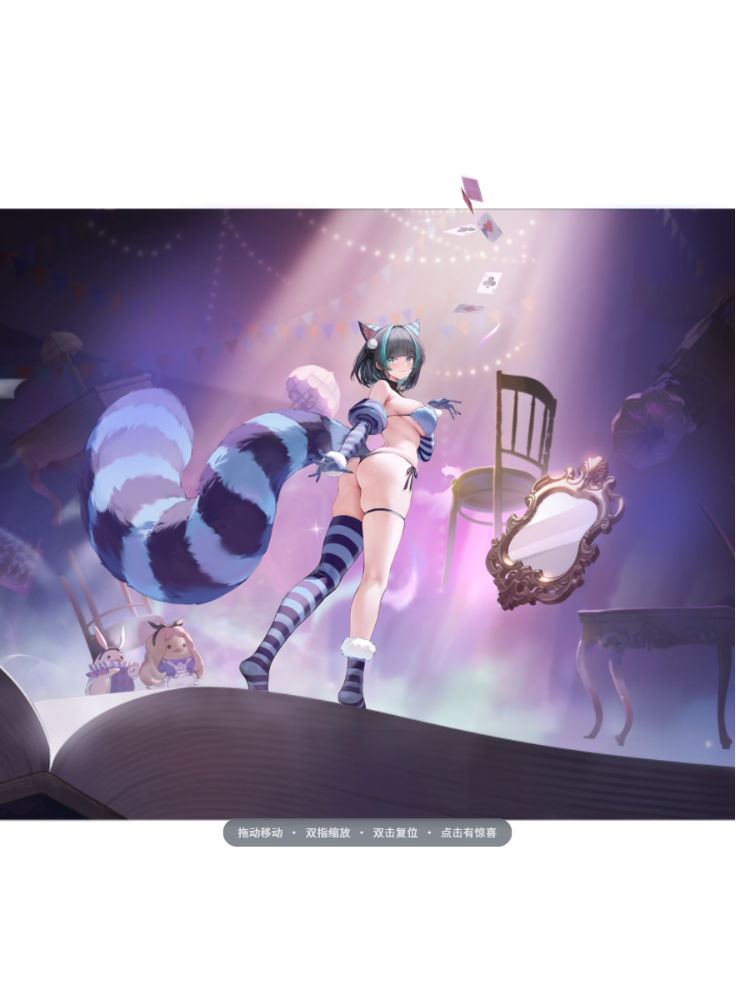
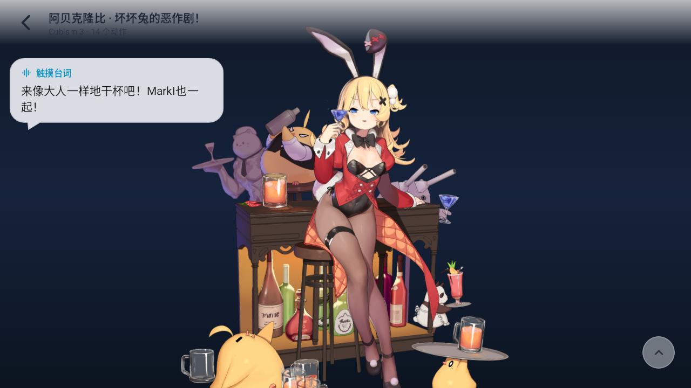

# 碧蓝航线 Live2D 资源包直读（技术说明）

> 目标：不装解包工具、不依赖电脑，在手机上直接把碧蓝航线的 Live2D 皮肤资源包（UnityFS）
> 解析成标准 Cubism 模型，并用应用内嵌的 WebView 渲染器播放。

本文记录逆向结论、实现结构与边界，供后续维护/扩展参考。

---

## 1. 资源形态逆向结论

以 `resource/test/chaijun_6` 为例（同一形态覆盖 `feiteliedadi_4`、`jinluhao_3`、`sailimiye_2`、`shi_3`、`shuixinghao_2`）：

| 项 | 结论 |
| --- | --- |
| 容器 | **UnityFS AssetBundle**，签名 `UnityFS\0`，v8，未加密 |
| 压缩 | 块压缩 `LZ4HC`（flags `0x243`），blocksInfo 位于头部后 **16 字节对齐** 处 |
| 内部节点 | 1 个 serialized file（`CAB-xxxx`）+ 1 个流式数据节点（同名 `.resS`） |
| 序列化文件 | 版本 **22**，`2022.3.62f3`，Android 平台，带完整 TypeTree |
| 模型数据 | 最大的 `MonoBehaviour(114)`：`m_Enabled` + `m_Script` + 名称 + `u32 长度` + **moc3 v5 原始字节** |
| 贴图 | 2 张 `Texture2D(28)`，4096×4096，`m_TextureFormat=48`（**ASTC 4×4**），数据在 `.resS` |
| 物理 | 唯一 `TextAsset(49)` = `<模型名>.physics3`（JSON） |
| 动作 | 113 个 `AnimationClip(74)`（Mecanim 通用片段，非 `motion3.json`；见 §7 动作还原） |
| 配置 | **包内没有 `model3.json`**，必须由客户端合成 |

关键坑（都已踩过并解决）：

1. blocksInfo 起点与块数据起点都要 **16 字节对齐**，否则读出来像"被 XOR 加密"。
2. blocksInfo 解压后前 16 字节是 `uncompressedDataHash`，随后才是块表；每块 **10 字节**（`u32 解压后大小`、`u32 压缩后大小`、`u16 flags`）。
3. SerializedFile v22 头是 **48 字节**且为 **大端**，而 metadata 由 `endianess` 字节（0=小端）决定，通常是小端。
4. TypeTree 的 `type` / `name` 是 **stringBuffer 偏移**，最高位 `0x80000000` 时改走 CommonString 表。
5. 读数组/字符串/`TypelessData`/`map` 后必须 **跳过整棵子树**，否则偏移立刻漂移。

---

## 2. 代码结构

```
app/src/main/java/com/azurlane/blyy/
├── util/unity/
│   ├── UnityBundle.kt             # UnityFS 头 / 块表 / 解压(LZ4, LZ4HC) / 节点表 / 流式读取
│   ├── SerializedFile.kt          # 序列化文件头 + 类型表 + 对象表
│   ├── TypeTree.kt                # TypeTree 通用值读取器 + CommonString 表
│   ├── UnityBundleSession.kt      # 一次性会话：解开 UnityFS + 复用解压镜像缓存 + 读 .resS
│   ├── UnityTextureExtractor.kt   # Texture2D 列表 / 解码落盘（RGBA32 翻转、按需降采样、旋转补偿）
│   ├── BitmapPixelOps.kt          # 像素矩形 180° 旋转（图集 rotate:180/270 归一化用）
│   ├── CompressedTextureDecoder.kt# ASTC(4x4/5x5/6x6/8x8/10x10/12x12)/ETC2/ETC1 → Bitmap
│   ├── AnimationClipDecoder.kt    # AnimationClip（streamed/dense/constant）→ 参数曲线 + CRC32 路径哈希
│   ├── Live2dRigIndex.kt          # GameObject/Transform 层级 → 参数 hash 索引（眨眼/口型识别）
│   ├── Motion3Builder.kt          # 参数曲线 → motion3.json（段槽位与 Cubism 解析器严格对齐）
│   └── AlLive2dExtractor.kt       # moc3 / physics3 / 贴图 / 动作 / model3.json 提取
├── util/gameimport/               # 游戏资源导入（独立功能，四类资源统一调度）
│   ├── GameAssetKind.kt           # live2d / char / spinepainting / painting
│   ├── GameAssetInfo.kt           # 资源快照、探测结论、id 与变体命名规则
│   ├── BundleProbe.kt             # 包内容判定（MOC3 / skel / 贴图 / 空壳预制体）
│   ├── SpineAtlasParser.kt        # .atlas 页解析 / 缩放改写 / rotate 语义归一化
│   ├── SpineBundleExtractor.kt    # char / spinepainting → 标准 Spine 三件套
│   ├── PaintingBundleExtractor.kt # painting → painting.png
│   ├── GameBundleImporter.kt      # 探测 → 分流提取 → 落库 → 写索引
│   ├── GameBundleScanner.kt       # Shizuku 扫描 / SAF 文件与目录导入
│   ├── GameAssetLibrary.kt        # 四类资源的目录布局、扫描、删除、重命名
│   └── GameImportIndex.kt         # 统一索引（含旧 live2d_bundle_index.json 迁移）
├── util/shizuku/
│   ├── ShizukuBridge.kt           # 权限申请 / UserService 绑定
│   └── BlyyShellService.kt        # 以 shell 身份执行 list/exists/readRange/copyTo
├── viewmodel/GameImportViewModel.kt        # 扫描 / 导入 / 库管理状态
├── viewmodel/GameAssetViewerViewModel.kt   # Spine 小人 / 动态皮肤 / 立绘查看
└── ui/screens/gameimport/
    ├── GameImportScreen.kt        # 独立入口（资源包 / 已导入 两个分区）
    └── GameAssetViewerScreen.kt   # Spine GL 实时渲染 + 立绘缩放浏览
```

AIDL：`app/src/main/aidl/com/azurlane/blyy/shizuku/IBlyyShellService.aidl`
（`listFiles` / `exists` / `sizeOf` / `lastModified` / `readRange` / `copyTo`）

### 数据流

```
游戏私有目录 .ys
   │  Shizuku UserService (shell UID) listFiles / copyTo
   ▼
cacheDir/live2d_bundles/<id>.src
   │  UnityFsBundle.decompressTo()  → cacheDir/al_live2d/<name>.img
   ▼
BundleImage + SerializedFile
   ├── MonoBehaviour  → model.moc3          （原样搬运，不解码）
   ├── TextAsset      → physics3.json       （JSON 原样写出）
   ├── Texture2D      → textures/*.png      （ASTC 4×4 → EGL 解码 → **按行倒序写回** → PNG，默认降到 2048²）
   ├── AnimationClip  → motions/*.motion3.json（113 条，按语义归组）
   └── 合成 <id>.model3.json                （Version 3 / FileReferences{Moc,Textures,Physics,Motions} / Groups）
   ▼
<externalFilesDir>/live2d/<id>/   ← 现有 Live2dLibrary 扫描即识别
   ▼
WebView + pixi-live2d-display（既有查看器，无需改动）
```

### 为什么能直接复用现有查看器

现有查看器通过虚拟域名 `https://live2d.local/models/<id>/…` 读模型目录，
只要生成的目录是标准 Cubism 结构（`*.model3.json` + `*.moc3` + `textures/` + `physics3.json`），
渲染链路完全不需要改。已经在桌面 Chromium（Cubism Core 5.1.0）上验证：
`chaijun_6` 的 moc3 v5 可被 Core 接受，贴图与物理正常加载。

---

## 3. 免重复扫描（持久化索引）

索引文件：`filesDir/live2d_bundle_index.json`

```json
{
  "version": 1,
  "roots": ["/sdcard/Android/data/com.bilibili.azurlane/files/AssetBundles"],
  "lastScanAt": 1730000000000,
  "entries": [
    {
      "path": "…/live2d/chaijun_6.ys",
      "size": 32474759,
      "modified": 1729000000000,
      "modelId": "chaijun_6",
      "status": "imported",
      "textureCount": 2,
      "moc3Bytes": 19944064,
      "textureSize": "4096x4096",
      "motionCount": 113,
      "extractorVersion": 2
    }
  ]
}
```

- 只有 **大小或修改时间（容差 2s）变化** 的文件才会重新解包；
- `extractorVersion` 落后于 `AlLive2dExtractor.EXTRACTOR_VERSION` 的条目会显示为
  **有更新**（贴图行序修复、动作生成等产物结构变化后自动提醒重解包）；
- 进入页面先用索引渲染（秒开），索引新鲜期（15 分钟）内不再访问游戏目录；
- 已删除的模型目录会自动从索引里剔除，避免"已导入却点不开"。

---

## 4. 已知边界

| 能力 | 状态 |
| --- | --- |
| Cubism 3/4 模型（`*.model3.json` + `.moc3`） | 完整支持 |
| moc3 v3 / v4 / v5 | 支持（内置 Cubism Core 5.1） |
| ASTC 4×4 / ETC2 RGB8 / ETC2 RGBA8 贴图 | 支持（GPU 解码） |
| RGBA32 未压缩贴图 | 支持 |
| LZMA / LZHAM 压缩资源包 | 不支持（会明确报错） |
| 动作（AnimationClip → `motion3.json`） | **支持**：解析 streamed/dense/constant 三类曲线，按语义归到 15 组（见 §7） |
| 眨眼/口型分组 | **支持**：从参数 GameObject 名识别 `ParamEyeLOpen/ParamEyeROpen/ParamMouthOpenY`，取不到就不写该组 |
| LZMA / LZHAM 压缩资源包 | 不支持（会明确报错） |

### 4.1 曾经的「渲染成一堆错位色块」根因（已修复）

早期导入的皮肤在查看器里呈现**大片色块 + 错位肢体**，一度被误判为"部件位置散乱 / 需要动作
摆姿势"。真正原因是 **贴图行序反了**：Unity 的压缩纹理（ASTC/ETC2）数据是**自下而上**
（OpenGL 约定）存放的，`glCompressedTexImage2D` 上传后数据第 0 行落在 v=0（帧缓冲底部），
而 `glReadPixels` 也从底部开始返回 —— 直接把读回的行序写进 `Bitmap`（自上而下）就得到**上下
镜像**的贴图。模型本身的几何/UV 都是对的，于是"每个部件都取到别的部件的纹理"，表现为一整片
错位色块。

修复：`CompressedTextureDecoder.decode()` 读回像素时按行倒序写入 `Bitmap`
（`dstRow = height - 1 - row`）。对照实验（同一 moc3，仅换贴图）：

| 贴图来源 | 结果 |
| --- | --- |
| Kotlin 解码（修复前） | 大片错位色块 |
| Kotlin 解码（行序翻转后） | 与官方导出模型一致 |
| Python 参考解码器（`texture2ddecoder` + `FLIP_TOP_BOTTOM`） | 与修复后逐像素等价（仅缩放滤波差异） |

> 顺带结论：moc3 v1/v2/v4/v5 的**默认姿势本身就是完整的**，之前怀疑的"Animator 才能摆正"
> 并不成立；`abeikelongbi_3` / `z46_3` 等老皮肤在行序修复后与官方 rip 渲染一致。

---

## 5. 动作还原（AnimationClip → motion3.json）

碧蓝的皮肤包里没有 `motion3.json`，动作是 Unity 的 **Mecanim 通用片段**（不是 humanoid
muscle 姿态）。动画根节点没有 Avatar，曲线直接打在 `CubismParameter` 的 `Value` 字段上，
所以可以精确还原成 Cubism 曲线：

1. **曲线数据**：`m_MuscleClip.m_Clip` 下三段择一/组合
   - `m_StreamedClip.data`：逐帧打包的关键帧
     `[time, keyCount, (curveIndex, c0, c1, outSlope, value)…]`，入切线按 Unity 的
     `StreamedCurveKey.CalculateNextInSlope` 回溯前帧计算（Stepped 曲线记 `+Inf`）；
   - `m_ConstantClip.data`：整段恒定的曲线（碧蓝里占多数，如 `ParamBodyAngleX = 0`）；
   - `m_DenseClip.m_SampleArray`：逐帧采样兜底（极少出现）。
2. **曲线 → 参数名**：`m_ClipBindingConstant.genericBindings[i].path` 是
   **`Animator.StringToHash(完整 GameObject 路径)`**，即**区分大小写**的标准 CRC-32
   （实测 `CRC32("Value") = 3702945584` = 所有绑定的 `attribute`）。用
   `GameObject(1)` + `Transform(4)` 还原层级 → 每层后缀都建一次索引 → 命中后取路径末段
   （`…/Parameters/ParamAngleX` → `ParamAngleX`，正是 moc3 的参数 id）。
3. **曲线分组**：片段名本身就是碧蓝的动作名，直接沿用语义分组
   （`touch_idle*`/`idle*` → `idle`；`touch_head` / `touch_body` / `touch_special` /
   `touch_drag*` / `main_1..3` / `login` / `home` / `mail` / `mission` / `mission_complete` /
   `complete` / `effect` / `wedding`）。这样查看器的点击互动、陪伴模式与语音场景表
   （摸头/普通触摸/特殊触摸/登录/誓约…）无需任何改动即可生效。
4. **`Groups`**：从参数命名识别眨眼/口型；碧蓝把部分参数泛化成 `ParamNN`，识别不到就不写
   该组（宁可不眨眼，也不要猜错参数把五官压扁）。

### 5.1 与 Cubism 解析器对齐的两个硬性约束（都踩过）

1. **只带起点、0 段的曲线仍然占一个 `segments` 槽位**：`CubismMotion.parse` 每轮循环先写
   `segments[o].basePointIndex`，循环末尾无条件 `++o`。常量曲线若写成 `Segments:[0, value]`
   就会写到预分配的 `TotalSegmentCount` 之外 → `TypeError: Cannot set properties of undefined`
   → 该动作加载失败（表现为"点了没反应 / 动作一条都出不来"）。因此常量曲线统一补一个覆盖
   整段时长的 Linear 段。
2. **`Meta.TotalSegmentCount` / `TotalPointCount` 必须精确**：解析器按这两个值预分配数组并
   逐段消费，多一个少一个都会让整条动作判为失败（日志里是
   `MotionManager: Failed to load motion`）。
   `Motion3Builder` 内部按「`max(1, 段数)` 槽位 / `1 + 段数` 点」累加，单测逐条复核。
3. 另一处容易踩的坑：**`Motions` 必须挂在 `FileReferences` 下**（放到根节点会被运行时忽略，
   模型能显示但一个动作都加载不出来）。

### 5.2 待机首尾闭合（陪伴模式无缝循环的前提）

碧蓝的 idle 剪辑是按「播一次 → 由游戏交叉淡化到下一段」制作的，**首尾并不闭合**。
实测 `chaijun_6` 的 82 条 idle 全部存在首尾差，典型是特效/开关类参数
（`TX_...` / `Circle_QTE_...` / `ParamNN`）从 0 直接跳到满量程 —— 一旦被原地循环，
每圈都会闪一下，这才是"待机循环首尾相接卡顿"的真实来源。

处理（`Motion3Builder(loopSeamless = true)`，仅对待机组启用）：

- 在最后 `SEAM_WINDOW_SEC = 0.35s` 内用 smoothstep（`3p²-2p³`）把值过渡到首帧值，
  窗口起点权重 0（与原曲线 C0/C1 连续）、终点权重 1（值精确等于首帧值）；
- 补一个 `t = duration` 的收尾点，运行时把 `startTime` 重置回 0 时参数不跳变；
- 非待机组（`touch_*` / `login` / `wedding` …）**不闭合**：它们是一次性动作，
  真实位移（如 `login` 的首尾差 1714）不能被抹掉。

实测（设备端真实产物）：29 条 idle 的首尾差全部为 `0.0000`；桌面逐圈采样显示
接缝处跨圈变化从 3~50 量级降到 **0.57 / 0.66**，接缝附近最大帧差仅 0.37
（最大的 3.13 出现在动作起播的入场淡入，不属于接缝）。

### 5.3 运行时两个必须绕开的坑（播放器侧）

`pixi-live2d-display 0.4.0` 与 model3.json 有两处语义不一致，都会让待机"播完就定格"：

| 坑 | 表现 | 处理 |
| --- | --- | --- |
| 待机组名硬编码 `{idle:'Idle'}` | 运行时队列清空后用 `startRandomMotion('Idle', IDLE)` 接待机；组名实际是 `idle` → 静默 no-op → 待机永久冻结（实测 5094ms 起连续 26 次 `ret=false`） | 模型 ready 后把 `motionManager.groups.idle` 接到模型真实拥有的待机组；`idleGroupNames()` 大小写不敏感解析 |
| JSON 的 `Loop` 不生效 | `CubismMotion.parse` 只写 `_motionData.loop`，而 `doUpdateParameters` 判断 `_isLoop` 成员（`setIsLoop` 从未被调用）→ 所有动作都当一次性播完 | 待机组加载完成后显式 `motion.setIsLoop(true)`（`motionLoaded` 事件 + 预载回调双保险）；`getDuration()` 返回 -1 表示循环态 |

> 这两处与数据侧闭合相互独立：只修播放器会「循环但每圈闪一下」，只修数据会
> 「不闪但播完定格」。两者都修才是无缝。

### 5.4 校验与实测

- 单测 `AnimationClipMotionTest`：113 条片段全部转换成功；逐条复核
  `TotalSegmentCount`/`TotalPointCount` 与解析器消费量一致；`touch_head` 含
  `ParamBodyAngleX` 曲线；动作组覆盖 `idle/touch_head/touch_body/touch_special/main_1/login/wedding`。
- 端到端（桌面 headless Chrome + 同一份 `viewer.js`）：113 条动作 `MotionManager.loadMotion`
  全部成功，`touch_head` 播放期间 `ParamBodyAngleX/ParamAngleX/ParamBreath` 连续变化。
- 真机（Android 14 + Shizuku 直读游戏目录）：8 个资源包批量重解包，
  生成 15~113 条动作/包；点击模型触发触摸动作并弹出对应语音台词
  （`播放互动语音: 触摸台词 · 坏坏兔的恶作剧！`）。

---

## 6. 排障

| 现象 | 原因 / 处理 |
| --- | --- |
| 「未找到碧蓝航线资源目录」 | 游戏未下载该皮肤，或 Shizuku 未授权；可在 Shizuku 里确认本应用已授权 |
| 「连接 Shizuku 服务超时」 | UserService 被系统回收，重试即可（8s 超时） |
| 「设备不支持该压缩纹理格式」 | GPU 无 ASTC 支持；目前仅能换设备/反馈机型 |
| 导入成功但画面发白/缺失 | 贴图被降到 2048²，属预期取舍；可在 `AlLive2dExtractor.extract(maxTextureSize)` 调整 |
| 「该资源包使用 LZMA 压缩」 | 该包压缩格式未支持，需先离线转换 |
| 画面正常但点击没动作 / 动作列表为空 | 旧产物（`pipelineVersion < 3`）没有动作文件：进入「游戏资源导入 → 资源包」筛选 Live2D，点 **全部导入**（或对单包点 **更新**）重解包 |
| 模型是"色块/错位" | 旧产物贴图行序错误：同上，重解包后即恢复（索引会把它标记为 **有更新**） |

---

## 7. 验证方式

- 单元测试：`app/src/test/java/com/azurlane/blyy/util/unity/`
  - `UnityBundleParseTest`：六个样本均为 UnityFS 且块/节点长度自洽；`chaijun_6` 解析出
    moc3 v5（19,944,064B）、2 张 4096² ASTC 贴图、physics3 TextAsset、113 个 AnimationClip。
  - `AnimationClipMotionTest`：`CRC32("Value") = 3702945584`；113 条片段全部转成 motion3，
    且逐条满足 Cubism 解析器的段/点计数契约（见 §5.1）。
- 手工验证：把 `resource/test/*` 拷进手机，用 **选择文件** 导入后点 **查看**。
- 端到端渲染验证（桌面 Chromium + Cubism Core 5.1.0，用从资源包提取的 moc3/贴图/物理喂给同一份
  `assets/live2d/viewer.js`）：

  

  > 该截图只用于验证「提取产物 + 既有渲染器」这条链路，纹理用了 1024² 预览版以减小体积。
- 真机回归（Android 14，Shizuku 直读游戏目录，8 个资源包批量重解包）：
  贴图不再镜像、动作按组生成（15~113 条/包），点击模型触发触摸动作并配对应语音台词。

  
